# 包裹助手 · ParcelPal

一个原生 SwiftUI 的快递 / 取件码管理 App：根据他人分享的 Scripting 脚本「包裹助手」改写为原生应用，
支持淘宝、菜鸟、京东、拼多多、丰巢、小米快递、快递鸟七个平台，本地识别短信、驿站分组、身份码、到站提醒与统计。

- **最低系统**：iOS 15.0（iPhone）
- **技术栈**：Swift 5 + SwiftUI + WKWebView + Keychain + UserNotifications，无第三方依赖
- **产物**：Release 里的 `ParcelPal-1.2.0-ios15-unsigned.ipa`（arm64、未签名，用于 TrollStore）

> 所有包裹、驿站、登录态只存在本机：数据写沙盒 `Application Support`，凭证写钥匙串，不上传任何服务器。
> 仓库里**没有任何演示数据**，首次启动就是空列表。

## 截图

| 取件 | 包裹 | 统计 | 智能识别 |
|---|---|---|---|
| 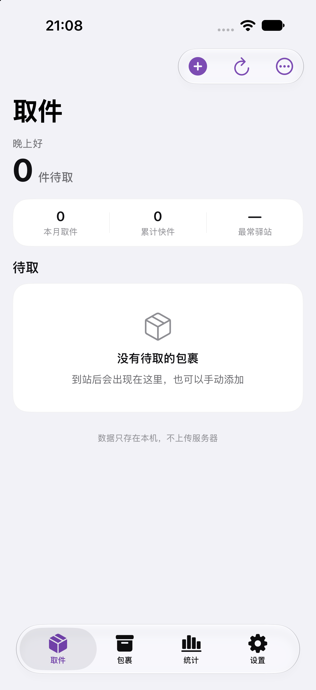 | 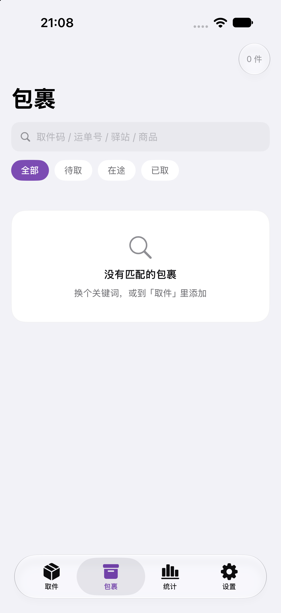 | 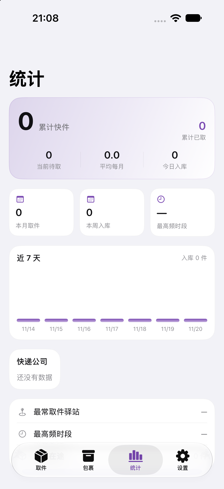 | 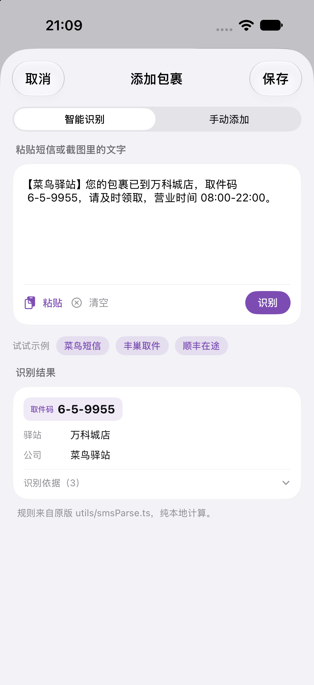 |

| 设置 | 设置（下半） | 关于 / 频道 | 平台授权 |
|---|---|---|---|
| 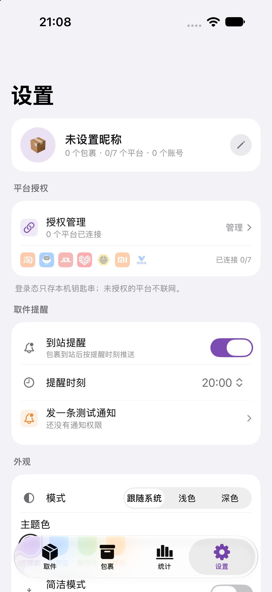 | 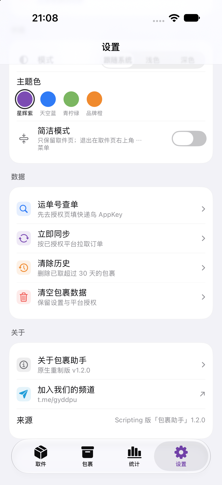 | 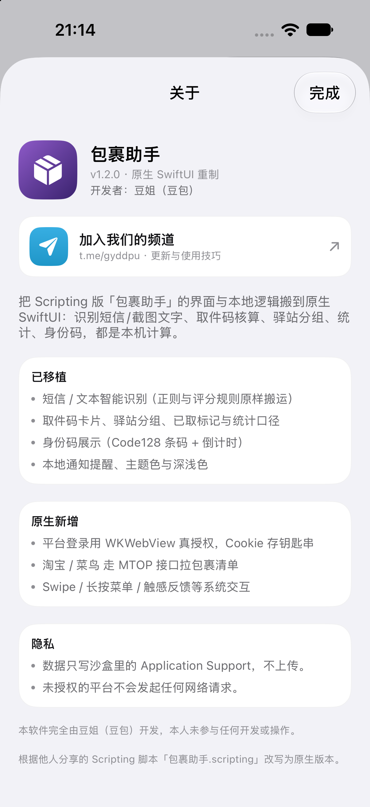 | 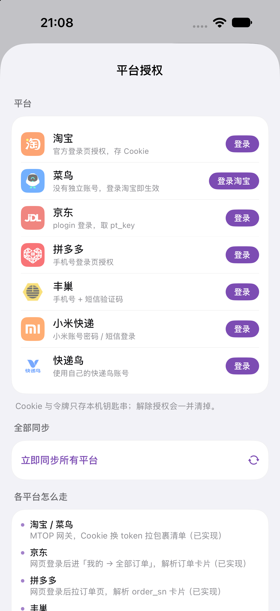 |

| 淘宝登录 | 小米登录 | 京东订单同步 | 简洁模式 |
|---|---|---|---|
| 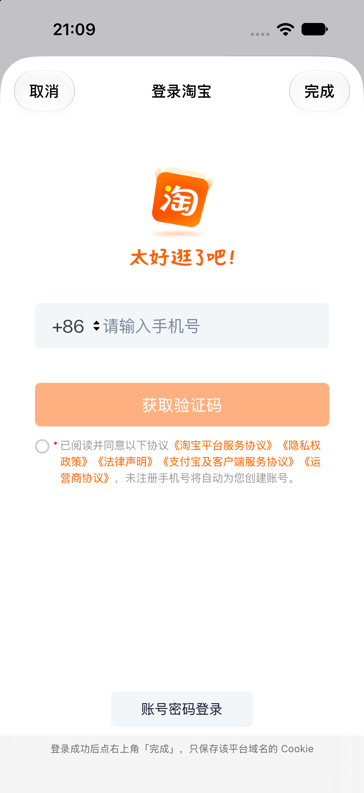 | 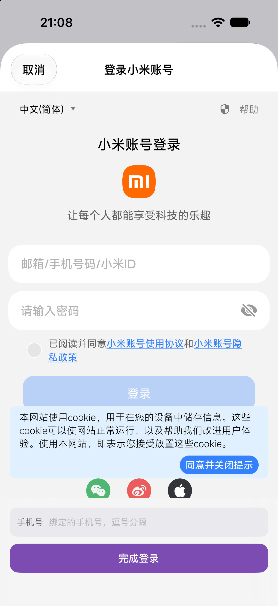 |  | 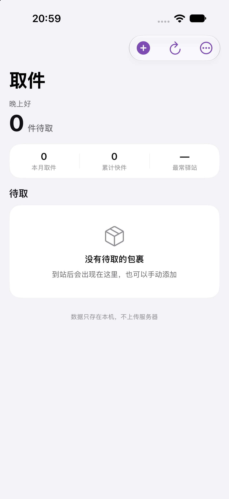 |

## 功能

- **取件页**：问候 + 待取数 + 三格统计、身份码入口、按驿站分组的取件码卡片、在途、最近已取
- **包裹页**：取件码 / 运单号 / 驿站 / 商品搜索，全部·待取·在途·已取筛选，多账号筛选
- **卡片**：快递公司 logo、取件码大字、来源平台小标、驿站、状态图标、相对时间、一键「标记已取」
- **详情**：Code128 条码、复制取件码、地图跳转、物流轨迹时间线、丰巢一键开柜、删除
- **智能识别**：粘贴短信 / 截图文字 → 取件码、运单号、驿站、快递公司、手机尾号，附「识别依据」
- **身份码**：淘宝 / 菜鸟身份码走平台接口实时下发（取不到会显示失败原因，不造本地假码）
- **统计**：累计快件、本月取件、本周、今日、近 7 天趋势、快递公司分布、最常驿站、高频时段
- **提醒**：本地通知，App 在前台也会弹横幅；权限被拒时一键跳系统设置
- **设置**：主题色（4 套）、深浅色、简洁模式、提醒时刻、运单号查单、清除历史、清空数据、频道入口
- **多账号**：每个平台可存多个账号，随时切换，不用重新登录

## 支持平台

| 平台 | 接入方式 | 能拿到 |
|---|---|---|
| 淘宝 | 官方登录页 WebView → Cookie 存钥匙串 | 订单、物流、取件码、身份码 |
| 菜鸟 | **无独立登录**，复用淘宝会话 | 包裹清单、取件码、实名身份码、运单号查件 |
| 京东 | `my.m.jd.com` → 全部订单 → DOM 卡片解析 | 订单号、状态、运单号、取件码 |
| 拼多多 | `orders.html` → `order_sn` 卡片解析 | 订单、状态、物流文案、取件码 |
| 丰巢 | 手机号 + 短信，RSA(PKCS1v15) 签名换 token | 在柜件、真实取件码、柜机格口、**一键开柜** |
| 小米快递 | 账号登录 → serviceLogin → serviceToken → AES-128-ECB 接口 | 聚合快递列表、轨迹、取件码 |
| 快递鸟 | 填自己的 EBusinessID + AppKey | 8001 即时查询（查单兜底） |

## 架构

```
Box/
├── Core/
│   ├── Models.swift        Parcel / CourierStation / IdentityCode / Settings / FcBoxMeta
│   ├── Store.swift         数据源（ObservableObject + JSON 持久化）、CRUD、统计
│   ├── AccountStore.swift  多账号仓库（钥匙串 accounts.v2 / accounts.active）
│   ├── SMSParser.swift     短信 / 文本识别（正则 + 评分）
│   ├── Company.swift       21 家快递公司 + 7 个平台定义
│   ├── Notifier.swift      本地通知 + 前台展示代理
│   ├── Barcode.swift       CoreImage Code128
│   ├── Theme.swift · Format.swift · SelfTest.swift
├── Net/
│   ├── Keychain.swift · PlatformSession.swift
│   ├── Crypto.swift        MD5 / SHA1 / AES-128-ECB / RSA-PKCS1v15（DER → SecKey）
│   ├── MTop.swift          淘宝 MTOP 网关（md5(token&t&appKey&data)）
│   ├── SyncService.swift   菜鸟 / 丰巢 / 小米 合并入库
│   ├── FengchaoService.swift   丰巢全流程（发码 → 登录 → 在柜件 → 开柜）
│   ├── XiaomiService.swift     小米 serviceLogin → serviceToken → 加密接口
│   ├── KdniaoService.swift     快递鸟 8001 + 快递100 单号识别
│   ├── IdentityService.swift   淘宝 / 菜鸟身份码
│   └── WebHarvest.swift        京东 / 拼多多订单页收割（WKWebView + JS）
└── UI/
    ├── PickupView / ParcelsView / StatsView / SettingsView
    ├── ParcelCardView / ParcelDetailView / AddParcelSheet
    ├── IdentitySheets / PlatformAuthView / PlatformLoginSheets
    └── Components.swift
```

## 数据与隐私

| 内容 | 存在哪 | 说明 |
|---|---|---|
| 包裹、设置、驿站 | 沙盒 `Application Support/Box/data.json` | 卸载才会清 |
| 平台 Cookie | 钥匙串 `accounts.v2` / `platform.cookies.*` | `kSecAttrAccessibleAfterFirstUnlock` |
| 丰巢 / 小米 token | 钥匙串（账号 blob） | 同上 |
| 快递鸟密钥 | 钥匙串（账号 blob） | 只本机 |

- 未授权的平台不会发起任何请求；除平台官方域名外，只有快递100（单号识别）与 OSRM（路线）两个公开服务。
- 「设置 → 数据 → 清空包裹数据」清空包裹 / 驿站，保留设置与授权。

## 登录态与多账号

- 登录一次后：退出 App、重启手机、TrollStore 覆盖安装、甚至卸载重装，钥匙串都还在（实测）。
- 淘宝 `_m_h5_tk` 过期会自动续；小米 serviceToken 过期会用 passToken 自动重换；京东 / 拼多多抓单前会把钥匙串 cookie 注入回 WebView。
- 平台自己踢会话（改密码 / 异地登录 / 长期不用）时才需要重新授权。
- 多账号：授权页「管理」里切换 / 添加 / 移除；菜鸟跟随淘宝账号。

## 安装（TrollStore）

1. 下载 [Release](https://github.com/Mac-XK/parcel-assistant/releases/latest) 里的 `ParcelPal-1.2.0-ios15-unsigned.ipa`
2. 传到手机 → 文件 App 里点击 → 共享 → **TrollStore → Install**
3. 首次启动按需允许通知；到「设置 → 平台授权」逐个登录

IPA 为未签名包（arm64，最低 iOS 15.0），由 TrollStore 本地签名，不需要开发者证书。

## 构建

```bash
# 模拟器
xcodebuild -project Box.xcodeproj -scheme Box \
  -destination 'platform=iOS Simulator,name=iPhone 18 Pro' \
  -configuration Debug -derivedDataPath /tmp/boxdd build

# 真机 / TrollStore 用的未签名 IPA
xcodebuild -project Box.xcodeproj -scheme Box -configuration Release \
  -sdk iphoneos -destination 'generic/platform=iOS' -derivedDataPath /tmp/boxrel \
  CODE_SIGNING_ALLOWED=NO CODE_SIGNING_REQUIRED=NO CODE_SIGN_IDENTITY="" build

cd /tmp/boxrel/Build/Products/Release-iphoneos
mkdir -p Payload && cp -R Box.app Payload/
zip -qry 包裹助手-1.2.0-ios15-unsigned.ipa Payload
```

## 调试

Debug 构建支持启动参数：

| 参数 | 作用 |
|---|---|
| `-tab0…-tab3` | 直接打开某个标签页 |
| `-sheet add\|about\|platforms\|login\|fc\|mi\|kd\|track\|harvestjd\|harvestpdd` | 直接弹对应页面 |
| `-sample` | 智能识别页自动填入示例并解析 |
| `-selftest` | 无 UI 跑一遍 添加 / 已取 / 统计 / 清历史 |
| `-acctest` | 多账号 增 / 切 / 覆盖 / 删 自测 |
| `-keytest` | 钥匙串持久化自测 |
| `-simple` / `-normal` | 切换简洁模式 |

## iOS 15 兼容

`@Observable` → `ObservableObject`、`NavigationStack` → `NavigationView`、`TextEditor` → `UITextView` 包装，
去掉 `contentTransition` / `.snappy` / `.scrollDismissesKeyboard` 等 iOS 16+ API，SF Symbols 也换成 iOS 15 自带的。
工程按 15.0 部署目标编译，新 API 会被编译器直接拦下。

## 已知限制

- 京东 / 拼多多的订单解析依赖网页 DOM，平台改版需要调整 `WebHarvest.swift` 里的 JS 选择器。
- 小米接口带 Android 设备字段（服务端是否校验未验证）；丰巢开柜需要真实在柜件。
- 拼多多身份码接口未接入，因此不显示入口；桌面小组件、灵动岛、位置围栏暂未实现。

## 说明与致谢

本项目是根据他人分享的 Scripting 脚本「包裹助手」改写而来的原生版本：界面用 SwiftUI 重写，
各平台的接口字段、请求签名、页面解析规则均沿用该脚本中已有的实现，按原逻辑移植到 Swift，
没有对任何平台做额外的抓包或分析。

- 原始脚本：Scripting 版「包裹助手」（作者分享的 `.scripting` 包）
- 本仓库：在上述脚本基础上做的原生 SwiftUI 重写与工程化

## 开发者

**此软件完全由豆姐（豆包）开发，本人没有参与任何开发或操作。**

## 频道

Telegram：[t.me/gyddpu](https://t.me/gyddpu)
